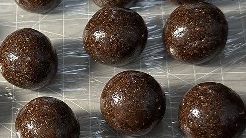

[简体中文](./README.md) | [English](./README.en.md)

# 凉澜丸（Femboy Pill）

## 项目简介（Project Overview）
凉澜丸是一副由纯草本药材制作的方剂，剂型为大蜜丸，主要构成为：五味子、百合、覆盆子、山茱萸等（完整方剂请查看[FORMULA.md](./FORMULA.md)）。凉澜丸旨在提高特定人群的相关体验：内敛浮火，控制边缘，润泽包裹，充盈待放。方剂构成忌讳热性与滋腻药材，对易上火体质与消化薄弱体质友好。参考实验体质：阴虚火旺。

## 项目性质（Project Nature）
凉澜丸不是一个可靠、成熟的方剂，而是一个实验性质的私人调理方，不能作为药物治疗疾病，不能盲目使用，仅供私人参考测试，实验有风险，尝试需谨慎。

## 当前状态（Current Status）
方剂迭代版本：第二版。个人实验已用（第二版）：80丸以上（9克每丸）。个人满意度：6分/10分。

## 安全提示（Safety Warning）
部分人群可能会对凉澜丸中的草本存在过敏反应。对于功能衰退型，阳虚（疲软、畏寒、萎靡）相关体质，凉澜丸可能加重体质不良状态。凉澜丸如与其它药物混用，可能导致副作用。长时间或大剂量使用凉澜丸，可能导致副作用。已知可能的部分副作用参考：关节酸痛、荨麻疹。

## 文档导航（Documentation Navigation）
安全提示：[safety.md](./docs/safety.md)

自述文件：[README.md](./README.md)

方剂文件：[FORMULA.md](./FORMULA.md)

蜜丸制法：[preparation.md](./docs/preparation.md)

实验用法：[usage.md](./docs/usage.md)

修订记录：[CHANGELOG.md](./CHANGELOG.md)

许可文件：[LICENSE](./LICENSE)

## 许可协议（License）

除非另有明确说明，本仓库中的原创文档及资料均采用 [知识共享署名 4.0 国际许可协议（CC BY 4.0）](https://creativecommons.org/licenses/by/4.0/deed.zh-hans) 授权。

在遵守该许可协议的前提下，任何人均可复制、传播、修改、改编及以其他方式使用本许可协议涵盖的材料，包括将其用于商业目的。

使用或再发布本仓库的相关材料时，须遵守以下要求：

- **署名：** 以适当的方式标明原作者或来源。
- **注明许可：** 提供本许可协议的链接。
- **标明修改：** 如对原始材料进行了修改，应以适当的方式说明。
- **不得暗示背书：** 不得以任何方式暗示原作者认可、支持或背书使用者及其产品，除非已获得相应授权。

本许可协议仅适用于本仓库中由相应权利人授权的材料。第三方文献、图片、表格及其他明确标注为第三方来源的内容，除非另有明确说明，否则不在本许可声明的授权范围内。使用此类材料时，应另行遵守其适用的版权规定及许可条件。

完整许可条款请参阅：[CC BY 4.0 法律文本](https://creativecommons.org/licenses/by/4.0/legalcode)或者[LICENSE](./LICENSE)文件。

## 免责声明（Disclaimer）

本仓库用于中药方剂及相关资料的记录、整理、学术交流与研究参考。仓库所收录的方剂组成、药材配比、炮制方法、制作工艺及相关说明，不构成针对任何个人的医疗诊断、治疗方案或用药建议。

本仓库所载内容不应被视为对任何方剂的安全性、有效性、质量或适用性的保证。传统使用记录、个人经验及相关文献记载，均不能单独证明某一方剂适用于特定人群或具有确定的临床疗效。

中药材的安全性与适用性可能受到药材基原、产地、炮制方式、剂量、个体差异、既往疾病、药物相互作用及其他因素的影响。未经充分评估，不应仅依据本仓库中的资料自行配制、服用或向他人提供相关制剂。

任何人基于本仓库内容作出的判断或采取的行动，均应由其自行审慎评估相关风险，并在必要时咨询具备相应资质的医疗专业人员。涉及药品生产、销售、宣传或其他受监管活动时，还应遵守适用的法律法规。

本仓库的维护者不对使用者因依赖、应用、修改或传播相关资料而产生的后果作出任何安全性或有效性保证。本免责声明不应被理解为排除任何依法不得排除的责任或法定权利。

